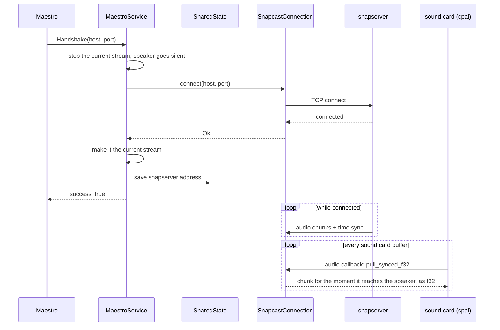

# Amp

##Raspberry Pi setup

Your Pi should've come with an SD card. If it didn't, find the nearest one and make sure it has enough memory (16GB should be fine).

## Requirements

- Raspberry Pi 3, microSD card, 5V 2.5A power supply (you should get all of these from FER)
- PC on the same network
- Ethernet cable (recommended for the first boot; Wi-Fi can be fixed later)
- Speaker on the 3.5 mm jack (or a monitor/TV for HDMI audio) - this can be used for testing until we get the screen

##TODO:
- running the existing Amp code on the Pi
- screen/speaker setup

##Step 1

On your PC, install the Raspberry Pi imager. On Linux, it can be done with:
```bash
sudo apt install rpi-imager
```
On Windows, download it and install it from [Rpi Imager](https://www.raspberrypi.com/software/).

Mount the SD card in your laptop. Open the imager and select the SD card as the drive.

In Raspberry Pi Imager:

1. Choose **Raspberry Pi OS Lite (64-bit)** and select the SD card. It lives under "Other Raspberry Pi OS".
2. When asked about OS customization, choose **Edit Settings** and set:
   - Hostname (for example `raspberrypi`)
   - Username `ivan` and a **freshly typed** password. If the field already shows a long string, it is a saved hash: delete it and type the password again.
   - **Enable SSH** with **Use password authentication**
   - Wi-Fi SSID, password and country (optional; Pi 3 Wi-Fi is 2.4 GHz-friendly)
3. Write the card. Writing overwrites the whole card, so formatting it first is unnecessary.

##Step 2

Before you boot the Pi for the first time, there are some additional precautionary steps. 
SSH and user sometimes might not be configured automatically, so you'll have to run these commands first.
With the SD card inserted into the laptop, run these commands:

For Linux:
```bash
echo 'yourpassword' | openssl passwd -6 -stdin
echo 'ivan:<paste-hash-here>' > /media/$USER/bootfs/userconf.txt
touch /media/$USER/bootfs/ssh
```

For MacOS:
```bash
brew install openssl
echo 'yourpassword' | $(brew --prefix openssl)/bin/openssl passwd -6 -stdin
echo 'ivan:<paste-hash-here>' > /Volumes/bootfs/userconf.txt
touch /Volumes/bootfs/ssh
```
For Windows:
```bash
'yourpassword' | & "C:\Program Files\Git\usr\bin\openssl.exe" passwd -6 -stdin
Set-Content -Path D:\userconf.txt -Value 'ivan:<paste-hash-here>' -Encoding ascii
New-Item D:\ssh -ItemType File
```
Replace the "D:" with the drive name Windows shows for it. Alternatively, you can run the Linux commands through WSL.

##Step 3

Your SD card is set up now. For the first boot, connect the Pi to the internet with an Ethernet cable.
Insert the SD card into the slot on the Pi and connect the power supply. Red LED will turn on, and the green LED will begin flashing. Wait until the green LED calms down.

On your PC, run:
```bash
ssh [username]@raspberrypi.local
```
"Username" is the one you set in the imager. Now you're controlling the Pi over your PC.

You can connect the Pi to Wifi now using the following commands:
```bash
sudo raspi-config nonint do_wifi_country XX
sudo rfkill unblock wifi
```

Replace "XX" with your country's two-letter code (e.g. HR for Croatia). Now you can run:
```bash
sudo raspi-config nonint do_wifi_country XX
sudo rfkill unblock wifi
```

Alternatively, you can do it via a menu:
```bash
sudo nmtui
```


##Step 4

Your PC and Raspberry Pi work on different architectures. Because of this, the project will have to be built inside a Docker for Raspberry Pi's architecture (ARM64). This step describes how to get the Docker images up and running.

Installation of an arm64 emulator is required, so download it using the following command:
```bash
sudo apt install -y docker.io qemu-user-static binfmt-support
```

Check the installation:
```bash
docker run --rm --platform linux/arm64 debian:trixie uname -m    # should print aarch64
```

Finally, load the images:
```bash
docker load < amp-build-images.tar.gz
docker images --filter "reference=qt-*"
docker run --rm --platform linux/arm64 qt-rust-arm64 sh -c 'rustc --version && qmake --version && protoc --version'
```

##Step 5

NOTE: these are the steps for the Linux PC. For Windows and Mac, either wait until I write those, or use Claude to translate them.

To build the Amp project, use these commands:
```bash
cd <repo-root>
grep -n -A15 "members" amp/Cargo.toml
```

The build commands:
```bash
mkdir -p ~/qt-pi/target-amp
cd ~/path/to/Amplify
docker run --rm --platform linux/arm64 \
  -v "$PWD":/work \
  -v ~/qt-pi/target-amp:/target \
  -v qt-cargo-registry:/root/.cargo/registry \
  -v qt-cargo-git:/root/.cargo/git \
  -w /work/amp \
  qt-rust-arm64 cargo build --release -p amp-app --target-dir /target
```

Now you can copy the build to your Raspberry Pi:
```bash
scp ~/qt-pi/target-amp/release/amp-app [your username]@raspberrypi.local:~/
```

And run it:
```bash
ssh ivan@raspberrypi.local
chmod +x ~/amp-app
LD_LIBRARY_PATH=/opt/qt6/lib QT_QPA_PLATFORM=offscreen ~/amp-app 2>&1 | tee ~/amp.log
```

## Linux setup

Needs Rust 1.88+, g++ and **Qt 6.12+**.

```
aqt install-qt linux desktop 6.12.0 linux_gcc_64 -O ~/Qt
curl -sSf https://sh.rustup.rs | sh
# add to your shell profile:
export QtDir=~/Qt/6.12.0/gcc_64
alias amp-run='PATH=$QtDir/bin:$PATH LD_LIBRARY_PATH=$QtDir/lib cargo run -p amp-app'
```

Then run `amp-run` from `amp/`. Qt Bridge for Rust comes from crates.io, so there's nothing to install for it.

## From handshake to music playing


