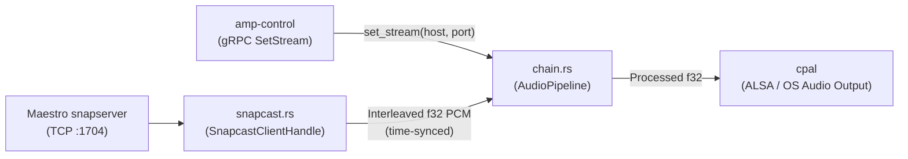

# `amp-audio` — Snapcast Client & DSP Audio Pipeline

This crate implements the audio reception and digital signal processing (DSP) pipeline for **Amp** (the Raspberry Pi amplifier node).

---

## 1. Architecture Overview

In **Amplify**, Spotify can only stream to a single active Spotify Connect device at a time. To play music across multiple amplifiers in perfect sync:
1. **Maestro** (C# laptop app) runs a single **Snapcast Server** (`snapserver`) fed by `librespot` (Spotify Connect).
2. **Amp** (Rust Raspberry Pi app) runs an embedded **Snapcast Client** (`amp-audio`) that connects to Maestro's `snapserver` over TCP (default port `1704`), synchronizes its clock, decodes the audio chunks, passes them through our DSP chain (`fundsp`), and plays them out through the sound card (`cpal`).



---

## 2. Key Technologies Explained (For the Team)

### What is `tokio`?
By default, Rust only knows how to run blocking code on OS threads. When an application needs to do multiple network and I/O tasks at the same time—such as:
- Listening for gRPC commands from Maestro (`amp-control`),
- Receiving TCP audio packets from `snapserver` (`amp-audio`),
- Sending periodic clock-sync ping messages every second,

we use **Tokio**, which is the standard **asynchronous runtime** (event loop / task scheduler) for Rust:
- **`async fn` / `.await`**: Marks a function that can pause while waiting for network data without freezing the thread.
- **`tokio::spawn(...)`**: Starts a lightweight background task on the Tokio runtime (similar to launching a background coroutine or `Task.Run` in C#).
- **`tokio::sync::mpsc`**: A "Multi-Producer, Single-Consumer" queue (channel). One background task pushes messages into the sender (`tx`), and another task reads them from the receiver (`rx`).
- **`tokio::select!`**: Waits on multiple async channels/timers at the same time and runs whichever branch finishes first.

### What is `snapcast-client` (`snapcast-rs`)?
Instead of spawning a separate C++ `snapclient` binary, we use the pure-Rust [`snapcast-client`](https://crates.io/crates/snapcast-client) crate (v0.18). It handles the binary Snapcast wire protocol:
1. **`Hello`**: Identifies this Amp to `snapserver`.
2. **`ServerSettings` & `CodecHeader`**: Receives the target buffer size (e.g. `1000 ms`), volume, and audio format (typically `FLAC`, `48000 Hz`, `16-bit`, `2 channels`).
3. **`Time`**: Exchanges timestamps with the server to calculate the exact clock offset (`TimeProvider`) between Maestro's laptop and the Raspberry Pi.
4. **`WireChunk`**: Decodes compressed audio frames into PCM and places them into a time-synchronized buffer (`Stream`) that performs **Hard Sync** (skipping/padding silence to align start time) and **Soft Sync** (nudging single samples to keep drift under `< 0.2 ms`).

### What are `fundsp` and `cpal`?
- **`fundsp`**: A Rust audio DSP library used in `chain.rs`, `crossover.rs`, `eq.rs`, `delay.rs`, and `volume.rs` to filter the audio (Left/Right/Woofer routing, low-pass/high-pass crossover, 10-band biquad EQ, delay line, and gain).
- **`cpal`** (*Cross-Platform Audio Library*): Talks to the operating system's low-level sound card API (ALSA on the Raspberry Pi / Linux, WASAPI on Windows, CoreAudio on macOS). `cpal` runs a high-priority audio thread that repeatedly asks our code to fill an output buffer `&mut [f32]` with samples.

---

## 3. Code Structure in `amp-audio`

- **[`src/chain.rs`](src/chain.rs)**:
  - `AudioPipeline`: Thread-safe (`Send + Sync`) audio controller held by `AmpHandler` in `amp-control`.
  - `AudioPipeline::set_stream(host, port)`: Stops any previous stream, spawns a new `SnapcastClientHandle`, and launches a dedicated `cpal` output worker thread that pulls time-synchronized stereo `f32` samples.
- **[`src/snapcast.rs`](src/snapcast.rs)**:
  - `SnapcastStreamConfig`: Holds connection parameters (`host`, `port`, `client_name`, `instance`).
  - `SnapcastClientHandle::spawn(cfg)`: Starts `SnapClient` on Tokio and exposes `event_rx`, `audio_rx`, and `pull_synced_f32(&mut [f32], dac_latency_usec)`.
- **[`examples/snapcast_demo.rs`](examples/snapcast_demo.rs)**:
  - Self-contained runnable demo. It connects to `127.0.0.1:1704` (or automatically spins up an embedded `SnapServer` on `127.0.0.1:1704` streaming a 440 Hz / 554.37 Hz stereo chord if no external server is running), logs all protocol events and chunk RMS levels, and plays the stream through `cpal`.

---

## 4. Running Tests & the Local Demo (Linux / WSL2 Ubuntu)

### Prerequisites on Ubuntu / WSL2
```bash
sudo apt-get update
sudo apt-get install -y build-essential pkg-config protobuf-compiler libasound2-dev libasound2-plugins
```

*(In WSL2, routing ALSA default output through WSLg PulseAudio allows audio to play through Windows speakers)*:
```bash
printf 'pcm.!default {\n    type pulse\n}\nctl.!default {\n    type pulse\n}\n' | sudo tee /etc/asound.conf
```

### Run Unit & Integration Tests
```bash
cargo test --target-dir ~/.cache/amplify-target -p amp-audio -p amp-control
```

### Run the Interactive Audio Demo
```bash
cargo run --target-dir ~/.cache/amplify-target -p amp-audio --example snapcast_demo
```

### Expected Demo Output
```text
=== Amplify: Local Snapcast Demo (amp-audio) ===
[Server] Port 1704 is free -> Starting local SnapServer on 127.0.0.1:1704 (FLAC 48000:16:2)...
[Server] Client connected: id=00:15:5d:d2:90:6c, name='Stage 1 Left (Local Test)', host='danipc' (linux/x86_64)
[Audio] Active output device: 'default' (StreamConfig { channels: 2, sample_rate: SampleRate(44100), buffer_size: Default })
[Client] Connected to snapserver at 127.0.0.1:1704
[Client] ServerSettings -> buffer: 400ms, latency: 0ms, vol: 100%, muted: false
[Client] StreamStarted  -> codec: flac, format: 48000Hz / 32bit / 2ch
[Audio] Chunk #1    | 2304 samples (48000Hz 2ch) | timestamp: 201648259 us | RMS: 0.141
[Audio] Chunk #50   | 2304 samples (48000Hz 2ch) | timestamp: 202808259 us | RMS: 0.141
[Audio] Chunk #100  | 2304 samples (48000Hz 2ch) | timestamp: 204008259 us | RMS: 0.141
[Audio] Chunk #150  | 2304 samples (48000Hz 2ch) | timestamp: 205208259 us | RMS: 0.141
[Audio] Chunk #200  | 2304 samples (48000Hz 2ch) | timestamp: 206408259 us | RMS: 0.141
[Client] TimeSyncComplete -> clock offset to server: 0.05 ms
[Audio] Chunk #250  | 2304 samples (48000Hz 2ch) | timestamp: 207608259 us | RMS: 0.141
[Audio] Chunk #300  | 2304 samples (48000Hz 2ch) | timestamp: 208808259 us | RMS: 0.142

[Demo] 8-second test completed. Total chunks received: 334
```
