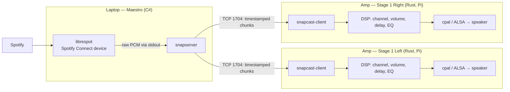

# Maestro

## Linux setup

Needs .NET 9+ SDK, CMake, g++ and **Qt 6.12+**.

```
aqt install-qt linux desktop 6.12.0 linux_gcc_64 -O ~/Qt
# add to your shell profile:
export QtDir=~/Qt/6.12.0/gcc_64
alias maestro-run='LD_LIBRARY_PATH=$QtDir/lib dotnet run --project Maestro.Desktop'
```

Then run `maestro-run` from `maestro/`. Qt Bridge for C# comes from NuGet, so there's nothing to install for it.

## macOS setup (Apple Silicon)
 
Needs .NET 9+ SDK, CMake and **Qt 6.12+**.
 
```
brew install aqtinstall         # or: pip install aqtinstall
aqt install-qt mac desktop 6.12.0 clang_64 -O ~/Qt
# add to your shell profile:
export QtDir=~/Qt/6.12.0/macos
alias maestro-run='DYLD_FRAMEWORK_PATH=$QtDir/lib dotnet run --project Maestro.Desktop'
```
 
Then run `maestro-run` from `maestro/`.

## Local file playback

Needs **ffmpeg** on the PATH (`brew install ffmpeg` / `winget install ffmpeg` / `apt install ffmpeg`) and Docker running with snapserver.

1. Start Maestro, paste the path of an audio file into the text field and press **Play**.
2. Connect a client: `snapclient -h 127.0.0.1` (macOS/Linux) or `docker/snapclient-rs.exe` / Snap.Net (Windows).

Expect ~1 s delay (snapclient buffer).

---

# Audio Streaming with Snapcast


## TL;DR

- Official **snapserver (C++) does not run on Windows**. Only the client has a Windows build.
- **Alternative:** use **`snapserver-rs`** (Rust reimplementation, native Windows build). Same project as the `snapcast-client` from AMP (random dude's side project)
- **Fallback:** official snapserver in **WSL2** with mirrored networking (that would suck tho)


## 1. Audio flow



| Component           | Runs on  | Job                                                                                                         |
| ------------------- | -------- | ----------------------------------------------------------------------------------------------------------- |
| **Spotify Web API** | Cloud    | Remote control only: search, queue, play/pause, transfer playback. Never delivers audio                     |
| **librespot**       | Laptop   | Appears as a Spotify Connect speaker. Receives the audio and writes raw PCM to stdout                       |
| **snapserver**      | Laptop   | Reads PCM, cuts it into chunks, encodes (FLAC), stamps each chunk with a play-at time, sends to all clients |
| **snapcast-client** | Each Amp | Syncs its clock to the server, buffers chunks, plays each at its stamped time.                              |
| **Amp DSP**         | Each Amp | Picks L/R/woofer from the stereo stream, applies volume, delay, crossover, EQ.                              |

**Glue step:** after snapserver starts, Maestro calls `GET /me/player/devices`, finds the librespot device, and calls `PUT /me/player` with its `device_id` to transfer playback.


## 2. How synchronization works

1. Server reads `chunk_ms` of audio, encodes it (FLAC default, ~26 ms codec latency), and stamps it with server time
2. Chunks go over TCP to every client
3. Each client repeatedly exchanges time messages with the server to compute clock offset
4. Each chunk is played at `timestamp + buffer`. Default `buffer` is **1000 ms**, so expect ~1 s from play/pause to audible change
5. Drift is corrected by dropping or duplicating single samples. Typical deviation is < 0.2 ms

**Ports (open on the laptop firewall):**

| Port | Protocol | Purpose |
|---|---|---|
| 1704 | TCP | Audio + time sync |
| 1705 | TCP | JSON-RPC control |
| 1780 | HTTP/WS | JSON-RPC + Snapweb UI |


## 3. Platform compatibility

| Component                         | Windows                                   | macOS                   | Linux / Pi         |
| --------------------------------- | ----------------------------------------- | ----------------------- | ------------------ |
| snapserver (C++, official, v0.35) | ❌ not supported                           | ✅                       | ✅ packages         |
| snapclient (C++, official)        | ✅ zip, needs `vc_redist`                  | ✅                       | ✅                  |
| snapserver-rs / snapclient-rs     | ✅ x86_64 binary                           | ✅ Intel + Apple Silicon | ✅ x86_64 + aarch64 |
| `snapcast-client` crate (Amp)     | ✅                                         | ✅                       | ✅                  |
| librespot                         | ⚠ build with `cargo` (no official binary) | ✅                       | ✅                  |
**Install with snapserver via Homebrew:** 
```
brew install snapcast
```


## Links

- Snapcast: https://github.com/snapcast/snapcast · [configuration.md](https://github.com/snapcast/snapcast/blob/master/doc/configuration.md) · [releases](https://github.com/snapcast/snapcast/releases)
- No Windows server: [Discussion #1032](https://github.com/snapcast/snapcast/discussions/1032), [Issue #1380](https://github.com/snapcast/snapcast/issues/1380)
- snapcast-rs: https://github.com/metaneutrons/snapcast-rs · crates: [snapcast-client](https://crates.io/crates/snapcast-client), [snapcast-server](https://crates.io/crates/snapcast-server)
- librespot: https://github.com/librespot-org/librespot · [Options wiki](https://github.com/librespot-org/librespot/wiki/Options)
- WSL networking (mirrored mode): https://learn.microsoft.com/en-us/windows/wsl/networking
